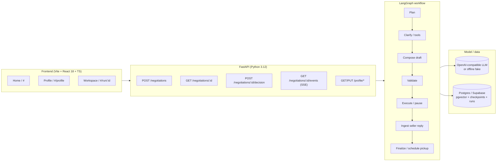

# Haggle

Haggle is an AI buyer's agent that negotiates the price of second-hand items on your behalf.
It plays two roles:

- **Practice mode:** haggles against a simulated seller so you can rehearse before contacting
  anyone.
- **Copilot mode:** drafts every message for you; *you* send each one yourself to a real seller on
  another app, then paste the seller's reply back. Nothing is ever sent automatically, and your
  maximum budget never reaches the AI.

Finished Copilot negotiations can be remembered under an anonymous per-browser profile, and
completed deals surface as "Similar past deals" on Home and as private history notes on the Item tab
of an active Copilot run.

See also [docs/copilot-mode.md](docs/copilot-mode.md) and [docs/profile-memory.md](docs/profile-memory.md).

---

## Key features

- **Two modes:** Practice (simulated seller, LangGraph-run) and Copilot (human-relayed, persisted in
  Postgres checkpoints so a run survives reloads and server restarts).
- **Human-in-the-loop:** nothing closes without your explicit "approve" (`approve_close` autonomy,
  sometimes called Level 2 in the UI text). The agent negotiates and pauses at the close gate
  waiting for your OK; in Copilot mode it also pauses before every seller message so you can review
  and edit the draft.
- **Safety guards:** deterministic code validators block over-budget offers, price leaks, private
  limit phrases, and ungrounded item claims before any message reaches the seller.
- **Item facts + grounding:** from pasted listing text and seller replies, facts (condition, age,
  warranty, defects, accessories, size, refresh rate, storage, battery health) are extracted,
  reconciled across sources, and asserted against drafts.
- **Market check:** enter up to eight comparable prices; Haggle shows the median and where your
  asking price and limit sit relative to it.
- **Pickup coordination:** after a finished Copilot deal, propose and book free pickup slots
  (hourly, 10 am–7 pm Malaysia time, 24h+ ahead) through its own calendar — never a personal
  calendar, never the seller's device.
- **Profile memory (anonymous):** a 32-char hex id lives in browser `localStorage`
  (`haggle.profileId`) and is sent as `X-Profile-Id`. Preferences (style, pickup window, area) and
  finished Copilot deals are stored; Practice runs are never remembered. Use **Forget** per deal or
  **Clear my memory** to delete everything for the current id.
- **Evaluation harness:** scenario runner, policy comparison (B1 prompt-only baseline vs Haggle),
  metrics, grounding checks, and frozen dev/test persona splits.

---

## Architecture overview

The frontend talks to FastAPI over HTTP (and SSE for live run traces). FastAPI runs a LangGraph
state machine whose nodes plan, compose, validate, execute, and finalize each negotiation. The LLM
is consulted through an OpenAI-compatible client (or an offline fake for tests); the graph never
executes an LLM proposal without a deterministic code validator. pgvector stores knowledge-base
chunks for semantic retrieval; profile memory and runs live in Postgres (Supabase).



---

## Tech stack

| Layer | Technology |
|-------|------------|
| Backend language | Python 3.12 |
| Backend framework | FastAPI |
| Workflow engine | LangGraph (state graph, Postgres checkpointer) |
| LLM client | OpenAI Python SDK (any OpenAI-compatible endpoint) |
| Database | Postgres (Supabase) with `pgvector` |
| Vector dimension | 384 (`HashEmbedder` test double or `BAAI/bge-small-en-v1.5` via fastembed) |
| Frontend | Vite + React 18 + TypeScript (strict), CSS modules |
| UI icons | lucide-react |
| Frontend unit tests | vitest |
| Frontend e2e | Playwright + axe-core (accessibility) |
| Backend tests | pytest |
| Lint | ruff (backend), eslint (frontend) |

Boundary adapters (MCP servers):
- `backend/app/boundaries/calendar_server.py` — `haggle-calendar` (propose/book/cancel pickup slots)
- `backend/app/boundaries/marketplace_server.py` — `haggle-marketplace` (open conversation, send offer/message)

---

## Prerequisites

- **Python 3.12** (with `pip` and `venv`)
- **Node.js** — version not pinned in the repo (no `engines` field, no `.nvmrc`); use a current LTS (**TODO**: confirm the target Node version)
- **npm**
- **Postgres database** reachable via `DATABASE_URL` (Supabase or self-hosted)
- **OpenAI-compatible API key** only if running with `HAGGLE_LLM=live` (offline fake is the default)

No Dockerfile, `docker-compose.yml`, or CI workflow exists in the repo, so setup is local and manual.

---

## Quick start (offline, no API key)

The offline `RuleBasedLLM` is the default, so you can run everything without an LLM API key.

**PowerShell:**

```powershell
# backend
python -m venv .venv
.\.venv\Scripts\Activate.ps1
pip install -r requirements.txt
python scripts/migrate.py
python -m uvicorn backend.app.api.main:app --port 8000
```

**macOS/Linux:**

```bash
# backend
python3 -m venv .venv
source .venv/bin/activate
pip install -r requirements.txt
python scripts/migrate.py
python -m uvicorn backend.app.api.main:app --port 8000
```

Then, in a second terminal:

**PowerShell:**

```powershell
cd frontend
npm install
npm run dev
```

**macOS/Linux:**

```bash
cd frontend
npm install
npm run dev
```

Open `http://localhost:5173`, choose **Practice** or **Copilot**, and start negotiating.

---

## Getting started (detailed)

### 1. Clone and configure

Create `.env` from `.env.example`:

**PowerShell:**

```powershell
Copy-Item .env.example .env
# edit .env — set DATABASE_URL at minimum
```

**macOS/Linux:**

```bash
cp .env.example .env
# edit .env — set DATABASE_URL at minimum
```

The API app (`backend/app/api/main.py`) calls `load_dotenv()` in its lifespan, so `.env` is loaded
automatically when you start the server — no manual export is required.

### 2. Backend setup

**PowerShell:**

```powershell
python -m venv .venv
.\.venv\Scripts\Activate.ps1
pip install -r requirements.txt
```

**macOS/Linux:**

```bash
python3 -m venv .venv
source .venv/bin/activate
pip install -r requirements.txt
```

Apply the database migrations:

**PowerShell:**

```powershell
python scripts/migrate.py
```

**macOS/Linux:**

```bash
python scripts/migrate.py
```

Optional: seed the listings/comparables/knowledge tables used by the market check and knowledge
base:

**PowerShell:**

```powershell
python scripts/seed.py
python scripts/seed_knowledge.py
python scripts/index_knowledge.py
```

**macOS/Linux:**

```bash
python scripts/seed.py
python scripts/seed_knowledge.py
python scripts/index_knowledge.py
```

### 3. Start the backend

**PowerShell:**

```powershell
$env:DATABASE_URL="<your database url>"
python -m uvicorn backend.app.api.main:app --port 8000
```

**macOS/Linux:**

```bash
export DATABASE_URL="<your database url>"
python -m uvicorn backend.app.api.main:app --port 8000
```

The app factory (`create_app` in `backend/app/api/main.py`) reads `HAGGLE_LLM`:
- unset or anything other than `"live"` → `RuleBasedLLM` (offline, deterministic — used by tests and e2e)
- `"live"` → `LLMClient` (real OpenAI-compatible model; set `LLM_MODEL`, `LLM_BASE_URL`, `LLM_API_KEY`)

CORS defaults to `http://localhost:5173`; override with `CORS_ORIGINS`.

### 4. Start the frontend

**PowerShell:**

```powershell
cd frontend
npm install
npm run dev      # Vite dev server, defaults to http://localhost:5173
```

**macOS/Linux:**

```bash
cd frontend
npm install
npm run dev
```

The Vite dev server proxies `/api` to `http://127.0.0.1:8000` (`frontend/vite.config.ts`), so the
frontend and backend must run together.

---

## Configuration

Backend environment variables (read in code):

| Name | Required? | Description | Example |
|------|-----------|-------------|---------|
| `DATABASE_URL` | Yes | Postgres connection string | `postgresql://...` |
| `HAGGLE_LLM` | No | `"live"` to use a real model; anything else uses the offline fake | `live` |
| `LLM_MODEL` | No (live only) | Model name | `gpt-4o-mini` |
| `LLM_BASE_URL` | No (live only) | OpenAI-compatible base URL | `https://api.openai.com/v1` |
| `LLM_API_KEY` | No (live only) | API key | `sk-...` |
| `EMBED_MODEL` | No | Embedding model for fastembed | `BAAI/bge-small-en-v1.5` |
| `CORS_ORIGINS` | No | Allowed CORS origins, comma-separated | `http://localhost:5173` |

`.env.example` currently lists `DATABASE_URL`, `LLM_BASE_URL`, `LLM_API_KEY`, and `LLM_MODEL`. To
keep it consistent with the table above, add `HAGGLE_LLM`, `EMBED_MODEL`, and `CORS_ORIGINS` to
`.env.example` (use placeholder values, never real secrets).

Frontend: no `.env` is read by the app; the Vite proxy target is hardcoded to
`http://127.0.0.1:8000` in `frontend/vite.config.ts`.

---

## Usage

### Start a negotiation (API)

```http
POST /negotiations
Content-Type: application/json
X-Profile-Id: <32-hex profile id, optional>

{
  "asking": 1200,
  "budget": 1000,
  "persona": "flexible",
  "style": "balanced",
  "autonomy": "approve_close",
  "seed": 0,
  "mode": "simulate",
  "item_title": "Dell 27 inch gaming monitor",
  "seller_opening": null,
  "category": "monitors",
  "listing_text": null,
  "comparables": null
}
```

Response:

```json
{ "id": "<run_id>" }
```

### Follow a run

- `GET /negotiations/{run_id}` — full snapshot (status, history, question gate, outcome, price,
  pickup, trace).
- `GET /negotiations/{run_id}/events` — SSE stream of trace events (`trace`, `gate`, `done`).
- `POST /negotiations/{run_id}/decision` with `{"verdict": "approve"}` — answer a pause gate.
- `POST /negotiations/{run_id}/reply` (Copilot) with `{"reply": "...", "sent_text": "..."}` — paste
  the seller's reply and what you actually sent.
- `GET /negotiations/{run_id}/pickup/options` and `POST /negotiations/{run_id}/pickup` — propose
  and book a pickup slot after a deal.

### Profile memory

- `GET /profile/preferences`, `PUT /profile/preferences` — save style / pickup window / area
- `GET /profile/deals` — finished Copilot deals
- `GET /profile/similar?title=...&category=...` — wording-matched past deals
- `DELETE /profile/deals/{run_id}` — forget one deal
- `DELETE /profile` — clear the whole profile

All profile endpoints require `X-Profile-Id`.

### How the LangGraph workflow runs

Nodes (in `backend/app/graph/nodes.py`, built by `build_graph` in `builder.py`):

1. **plan** — strategy decides offer / accept / walk away / ask question (never talks to the seller
   directly).
2. **clarify** (optional) — tool loop: read listing, market stats, knowledge base, or ask the
   seller one question; capped at 4 tool steps / 2 questions.
3. **compose** — LLM drafts the buyer message from the decision + public context (budget never in
   the prompt).
4. **validate** — deterministic gate: no over-budget/above-asking offers, no price leaks, no
   ungrounded item claims. Rejected drafts are retried then replaced by a code fallback.
5. **execute** — send to the seller (Practice) or pause with the draft for the human to relay
   (Copilot `approve_close`); on accept there is a close-deal approval gate.
6. **ingest** — read the seller's reply: price, acceptance, walk-away, budget probe, pressure,
   term change. Phantom deals are rejected; only the buyer's own offered price counts.
7. **finalize** — outcome: deal / we_walk / seller_walks / timeout.
8. **schedule** (when a calendar is wired and the run is a deal) — propose and book the earliest
   free pickup slot; a failure never undoes the deal.

Interrupts (human-in-the-loop): `close_deal` (approve the final price) and `book_pickup` (confirm
the slot).

---

## Project structure

Short tree (2–3 levels):

```
.
├── README.md
├── pyproject.toml            # ruff + pytest config
├── requirements.txt          # Python dependencies
├── .env.example              # env var names (placeholders only)
├── scripts/                  # one-off and eval scripts (migrate, seed, run_eval, demo_*, …)
├── backend/
│   ├── app/
│   │   ├── api/              # FastAPI app, service, run store, schemas
│   │   ├── graph/            # LangGraph workflow: builder, state, nodes, control, ports
│   │   ├── core/             # models, strategy, validation, outbound checks
│   │   ├── llm/              # client, fake, compose/extract/clarify prompts
│   │   ├── knowledge/        # facts, grounding, retrieval, pgvector search
│   │   ├── memory/           # profile + past-deals persistence
│   │   ├── sim/              # personas + simulated seller
│   │   └── boundaries/       # MCP servers: calendar, marketplace
│   ├── db.py                 # psycopg connection helper
│   └── tests/                # pytest suite
├── db/migrations/            # 001_init … 007_profile_memory
├── knowledge/                # knowledge-base sources (laptops, monitors, phones)
├── docs/                     # copilot-mode.md, profile-memory.md, architecture.md
└── frontend/
    ├── src/                  # App, api, useNegotiation, types, lib, ui, features, e2e
    └── e2e/                  # Playwright specs + helpers
```

The full annotated tree lives in [docs/architecture.md](docs/architecture.md).

---

## Development

### Backend

**PowerShell:**

```powershell
ruff check .
.\.venv\Scripts\python.exe -m pytest backend/tests -q --ignore=backend/tests/test_db.py
```

**macOS/Linux:**

```bash
ruff check .
python -m pytest backend/tests -q --ignore=backend/tests/test_db.py
```

### Frontend

**PowerShell:**

```powershell
cd frontend
npm run lint
npm test
npm run build
npm run preview
$env:HAGGLE_LLM=""
npm run e2e
```

**macOS/Linux:**

```bash
cd frontend
npm run lint
npm test
npm run build
npm run preview
HAGGLE_LLM="" npm run e2e
```

Playwright runs at 1440×900 in light theme only; no mobile, tablet, or dark-theme tests exist.
The e2e suite starts the FastAPI backend and Vite dev server itself
(`frontend/e2e/global-setup.ts`) and cleans negotiation runs and profile rows afterwards
(`frontend/e2e/global-teardown.ts` → `scripts/delete_run.py` / `scripts/delete_profiles.py`).

### Evaluation scripts

From the repo root (offline fakes by default; pass `--live` to use a real model):

**PowerShell:**

```powershell
python scripts/run_scenarios.py
python scripts/run_eval.py --split dev
python scripts/run_eval.py --split test
python scripts/compare_b1.py
python scripts/eval_grounding.py
```

**macOS/Linux:**

```bash
python scripts/run_scenarios.py
python scripts/run_eval.py --split dev
python scripts/run_eval.py --split test
python scripts/compare_b1.py
python scripts/eval_grounding.py
```

Results are written to `eval/reports/` as `eval_<split>_<unix_ts>.json`.

---

## Deployment notes

The repo contains no Dockerfile, `docker-compose.yml`, or CI workflow, so there is no codified
deployment path. The backend is a standard FastAPI app (`uvicorn backend.app.api.main:app`) and the
frontend is a standard Vite build (`npm run build` → `dist/`), deployable to any host that runs
Python 3.12 + Node and can reach the configured Postgres database.

---

## Troubleshooting

- **`DATABASE_URL` not set:** the server fails to start. Set it in `.env` (loaded automatically)
  or export it before running uvicorn.
- **Frontend can't reach the API:** confirm the backend is on `http://127.0.0.1:8000`; the Vite
  proxy target is hardcoded there in `frontend/vite.config.ts`.
- **Profile memory 503:** `DELETE /profile` is a safe no-op for an unknown id; a 503 means the
  memory dependency isn't reachable — retry or check the database.
- **Run stuck at a gate:** Copilot runs pause at `close_deal` (and `seller_reply` for each draft)
  until you answer via `POST /negotiations/{run_id}/decision` or `/reply`. The SSE stream
  (`/events`) shows the current gate.
- **No similar deals shown:** similarity is wording-based (not semantic), and only finished Copilot
  deals with a final price qualify; Practice runs are never remembered.

---

## Contributing

1. Fork the repo and create a branch.
2. Make changes, keeping tests green:
   - `ruff check .` + backend pytest
   - `npm run lint` + `npm test` + `npm run e2e` (frontend)
3. Do not commit secrets; `.env` is local-only and `.env.example` contains names only.
4. Open a pull request describing the change and which scenarios/eval splits it affects.

### License

No `LICENSE` file exists in the repository.
