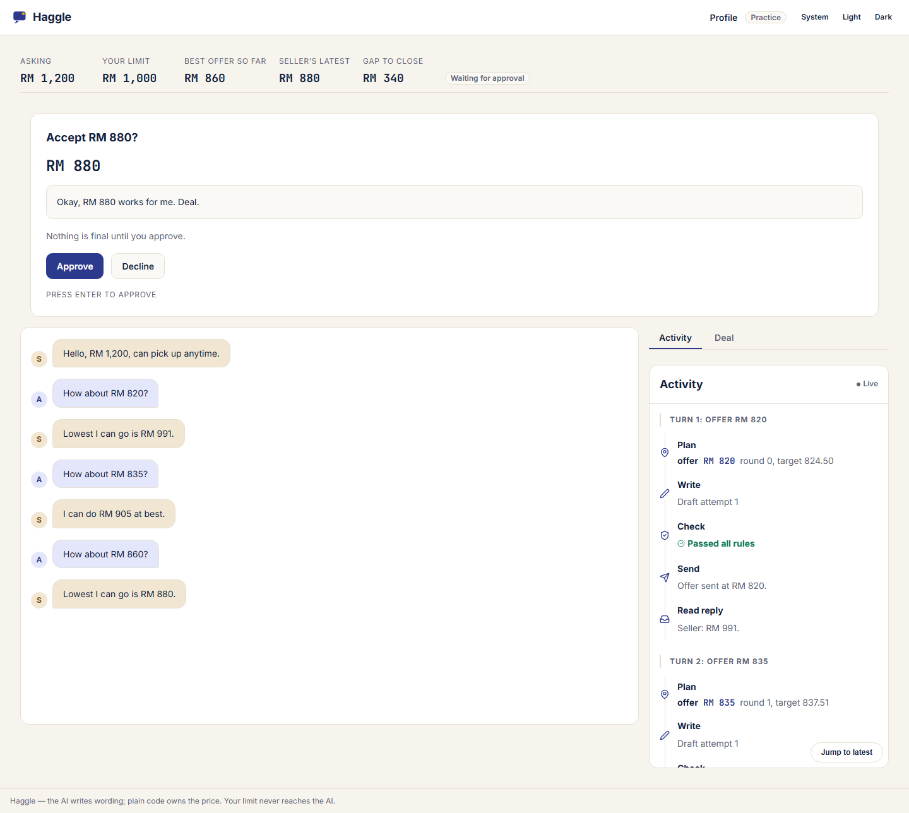
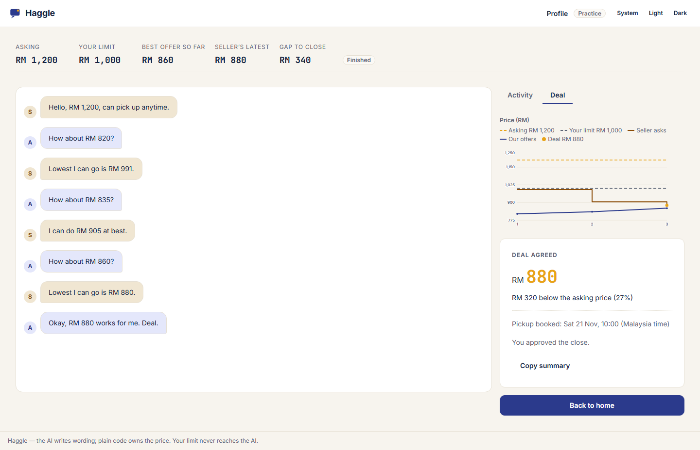
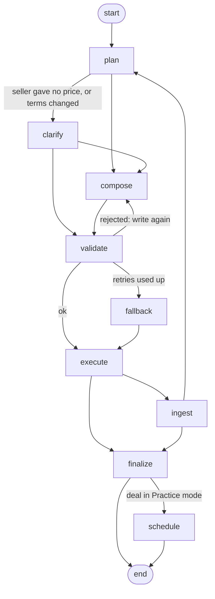
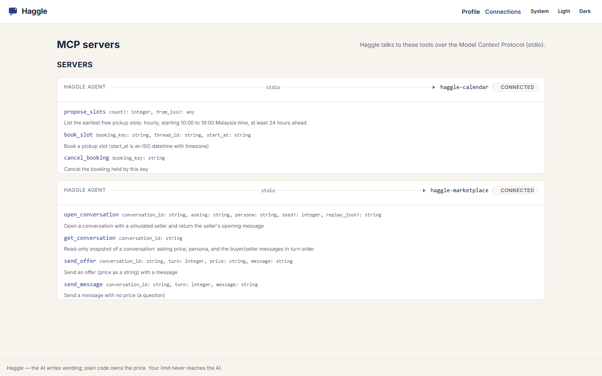
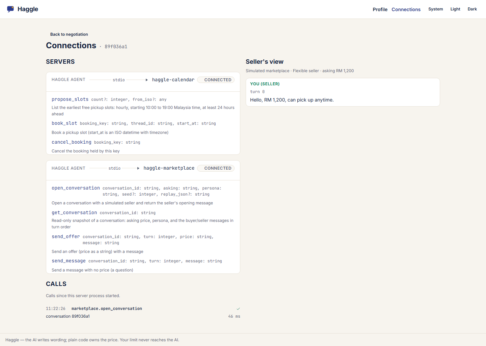

# Haggle

Haggle is an AI buyer's agent that negotiates the price of second-hand items on your behalf.
It plays two roles:

- **Practice mode:** haggles against a simulated seller so you can rehearse before contacting
  anyone.
- **Copilot mode:** drafts every message for you; *you* send each one yourself to a real seller on
  another app, then paste the seller's reply back. Nothing is ever sent automatically, and your
  maximum budget never reaches the AI.

Finished Copilot negotiations can be remembered under an anonymous per-browser profile, and
completed deals surface as "Similar past deals" on Home and as private history notes on the Item tab
of an active Copilot run.
See also [docs/copilot-mode.md](docs/copilot-mode.md) and [docs/profile-memory.md](docs/profile-memory.md).


**Live demo:** https://haggle-xi.vercel.app

The demo runs on free hosting, so the first request after a quiet period can take up to a minute
while the backend wakes up. There is no login, so please keep it to a few test negotiations.

---

## Screenshots

| | |
|---|---|
|  |  |
|  |  |

Home, a run waiting for your approval, the Copilot composer, and the outcome of a finished deal.

---

## Key features

- **Two modes:** Practice (simulated seller, LangGraph-run) and Copilot (human-relayed, persisted in
  Postgres checkpoints so a run survives reloads and server restarts).
- **Human-in-the-loop:** nothing closes without your explicit "approve" (`approve_close` autonomy,
  shown in the UI as "Ask me before closing"). The agent negotiates and pauses at the close gate
  waiting for your OK; in Copilot mode it also pauses before every seller message so you can review
  and edit the draft.
- **Safety guards:** deterministic code validators block over-budget offers, price leaks, private
  limit phrases, and ungrounded item claims before any message reaches the seller.
- **Item facts + grounding:** from pasted listing text and seller replies, facts (condition, age,
  warranty, defects, accessories, size, refresh rate, storage, battery health) are extracted,
  reconciled across sources, and asserted against drafts.
- **Market check:** enter up to eight comparable prices; Haggle shows the median and where your
  asking price and limit sit relative to it.
- **Pickup coordination:** after a finished Copilot deal, propose and book free pickup slots
  (hourly, 10 am–7 pm Malaysia time, 24h+ ahead) through its own calendar — never a personal
  calendar, never the seller's device.
- **Profile memory (anonymous):** a 32-char hex id lives in browser `localStorage`
  (`haggle.profileId`) and is sent as `X-Profile-Id`. Preferences (style, pickup window, area) and
  finished Copilot deals are stored; Practice runs are never remembered. Use **Forget** per deal or
  **Clear my memory** to delete everything for the current id.
- **Research before offering:** when the seller has not stated a price, the agent can read the
  listing, check market statistics, search a small buying-guidance knowledge base (pgvector) and ask
  the seller a question. These tools are read-only and listed in [docs/tools.md](docs/tools.md).
- **Categories:** eight item categories (monitors, phones, laptops, cameras, consoles, furniture,
  appliances, other) define their keywords, extra item facts and guidance in one table; if you do
  not pick one, Haggle guesses it from the title.
- **Evaluation harness:** an offline suite compares Haggle's price strategy with simple baselines on
  frozen seller splits, with confidence intervals and a blind test that is scored once. See
  [Evaluation](#evaluation).
- **Test without an API key:** `HAGGLE_LLM=offline` swaps the language model for a rule-based
  stand-in, so the test suites and the browser tests never call a real model. Log lines carry the
  run id and never contain prompts, messages or your limit.

### Copilot marketplace channel

Copilot normally has you relay every message yourself: Haggle drafts it, you send it on another app,
then you paste the seller's reply back. With the **marketplace channel**, the approved message is
instead sent to a simulated marketplace seller that runs as an MCP server (stdio, separate process),
and the seller's reply comes back as the tool result. Every message waits for your approval first,
you may edit the draft before it is sent, and the edited text is re-validated by the same rule
check. Your hidden maximum budget never reaches the model. The simulated seller is rule-based and
persona-driven, not a real marketplace, and it only runs when `MARKETPLACE_CHANNEL=on`.

---

## Why not just ask a chat assistant?
A chat assistant is good at wording a message. Negotiating on someone's behalf needs more, and a chat
window cannot promise it:

- **Your limit stays private.** The model only writes wording; it never sees your maximum budget.
  Plain code decides every price and checks every message before it can be sent: no offer above your
  limit, no leaked limit, no invented item facts.
- **It acts, not only advises.** It keeps state across rounds, looks up market prices and buying
  guidance, asks the seller questions, pauses for your approval before anything closes, and books a
  pickup time without double-booking.
- **It is measured.** The price strategy and the safety checks are evaluated offline with blind rounds
  and paired confidence intervals, including where Haggle loses (see [Evaluation](#evaluation)).

I did not benchmark Haggle against ChatGPT or any live model. The comparisons below are against
simple policies.

---

## Architecture overview

The language model proposes; plain code validates and executes. The model writes the wording of a
message and proposes what it read in the seller's reply. Code owns the price, the rules a message
must pass, and every action with side effects. Full detail: [docs/architecture.md](docs/architecture.md).



| Decision | Owner |
|---|---|
| The price of the next offer | code (`core/strategy.py`) |
| The wording of a message | the model |
| Reading the seller's reply | the model proposes, code reconciles (`llm/guards.py`) |
| Whether a draft may be sent | code (`core/outbound.py`, `core/validate.py`, `knowledge/grounding.py`) |
| Which read-only lookup to run | the model chooses, code runs and validates (`tools.py`) |
| Booking a pickup | code, through a calendar MCP server |

---

## Evaluation

The price strategy and the safety checks are evaluated offline, without a language model, against
rule-based seller simulators written by the author. A negotiation is scored by the share of the
seller's room to move that the buyer captured (1.0 means bought at the seller's hidden floor). No
deal, an offer above the budget or a leaked limit counts as 0, so a policy cannot look good by
breaking rules. Intervals are 95% bootstrap intervals over independent cases (seller x budget
ratio), and comparisons are paired: the same negotiation under each policy.

**Round 1: blind test** (4 unseen sellers, 420 negotiations per policy, scored once, code version
`037a4ef`; full report in `eval/reports/final_test_report.md`):

| policy | deal rate | score [95% CI] | rule violations |
|---|---|---|---|
| haggle_balanced | 56% | 0.465 [0.263, 0.659] | 0% |
| b3_capped_ladder (budget-aware fixed ladder) | 83% | 0.519 [0.375, 0.644] | 0% |
| b2_fixed_discount (ignores the budget) | 100% | 0.380 [0.250, 0.514] | 57% |

**Round 2: labelled experiment** (6 new sellers, 630 negotiations per policy, code version
`1e0eb55`; plan in `docs/eval_round2_plan.md`; report in `eval/reports/round2_test_report.md`):

| policy | deal rate | score [95% CI] | rule violations |
|---|---|---|---|
| haggle_balanced_v2 | 52% | 0.455 [0.284, 0.628] | 0% |
| haggle_balanced (round 1 style) | 37% | 0.323 [0.168, 0.493] | 0% |
| b3_capped_ladder | 88% | 0.534 [0.439, 0.626] | 0% |
| b2_fixed_discount | 100% | 0.377 [0.266, 0.484] | 60% |

To reproduce, run `python scripts/run_eval.py --split dev` for development sellers, or
`--split test --final` / `--split test2 --final` for the scored splits (clean git tree required;
see [docs/development.md](docs/development.md) for details).

Haggle never broke a rule in either test round. It ties the fair baseline: safe and competitive,
not better. Against sellers who leave quickly (round 2: 0 deals against `short_fuse` and
`brisk_firm`) it loses deals, and a missed deal counts as 0.

## Strategy parameters

The evaluation tables above use the **round-1 strategy parameters**: opening ratio 0.70 and
opening cap 0.85 (`backend/app/core/strategy.py`, `StrategyParams`). After round 1 the defaults
were softened for user experience — opening ratio 0.80 and opening cap 0.90 — which raises the
deal rate at the cost of a lower share of surplus per clean deal. A one-off DEV-split comparison
of round 1 vs the softened opening is in `eval/reports/round3_opening_softening.md`
(deal rate 67% -> 73%, 0 rule violations for both). The round-2 grid
(`backend/app/evaluation/round2.py`, `OPENINGS` / `BETAS`) is unchanged; `V1_CANDIDATE` pins the
round-1 parameters explicitly so the round-1 style stays reproducible.

The Copilot e2e suites also include input-variation tests (form values, API validation, seller
replies, price scales, edits, all personas). These tests found a real bug: an edited message was
validated but the seller received the original draft. The bug is now fixed and covered by backend
and e2e tests.

---

## Tech stack

| Layer | Technology |
|---|---|
| Backend language | Python 3.12 |
| Backend framework | FastAPI |
| Workflow engine | LangGraph (state graph, Postgres checkpointer) |
| LLM client | OpenAI Python SDK (any OpenAI-compatible endpoint) |
| Database | Postgres (Supabase) with `pgvector` |
| Frontend | Vite + React 18 + TypeScript (strict), CSS modules |
| UI icons | lucide-react |
| Frontend tests | vitest |
| Backend tests | pytest |
| Lint | ruff (backend), eslint (frontend) |

Boundary adapters (MCP servers):
- `backend/app/boundaries/calendar_server.py` — `haggle-calendar` (propose/book/cancel pickup slots)
- `backend/app/boundaries/marketplace_server.py` — `haggle-marketplace` (open conversation, send offer/message)

---

## Prerequisites

- **Python 3.12** (with `pip` and `venv`)
- **Node.js** (developed on v24; any current LTS should work) and **npm**
- **Postgres with the pgvector extension**, reachable through `DATABASE_URL` (a Supabase project
  works; the first migration enables the extension)
- **A language model**, either an OpenAI-compatible endpoint (`LLM_MODEL`, `LLM_BASE_URL`,
  `LLM_API_KEY`) or the built-in offline stand-in (`HAGGLE_LLM=offline`, no key needed)

No Dockerfile, `docker-compose.yml` or CI workflow exists in the repo, so setup is local and manual.

---

## Quick start

Copy `.env.example` to `.env` and set `DATABASE_URL`. Then choose how the language model runs:

- **Real model:** set `LLM_BASE_URL`, `LLM_API_KEY` and `LLM_MODEL` (any OpenAI-compatible endpoint).
- **No API key, to try it out:** set `HAGGLE_LLM=offline`. A rule-based stand-in writes the messages:
  everything works, with plainer wording.

Full step-by-step setup (venv, migrations, frontend) is in [docs/setup.md](docs/setup.md).

Open `http://localhost:5173`, choose **Practice** or **Copilot**, and start negotiating.

---

## Configuration

Only `backend/app/settings.py` reads the environment (a test enforces it).

| Variable | Needed | Meaning |
|---|---|---|
| `DATABASE_URL` | yes | Postgres connection string |
| `LLM_BASE_URL`, `LLM_API_KEY`, `LLM_MODEL` | live model only | OpenAI-compatible endpoint, key and model name |
| `LLM_TIMEOUT_S` | no | per-call timeout to the model in seconds (default `45`) |
| `LLM_MAX_RETRIES` | no | retries on transient failures only: 429/5xx/timeout/connection (default `3`) |
| `HAGGLE_LLM` | no | the exact word `offline` selects the rule-based stand-in; anything else (or unset) means the live model |
| `EMBED_MODEL` | no | embedding model for the knowledge search (default `BAAI/bge-small-en-v1.5`) |
| `LOG_LEVEL` | no | `DEBUG`, `INFO` (default), `WARNING` or `ERROR` |
| `CORS_ORIGINS` | no | comma-separated allowed browser origins (default `http://localhost:5173`) |
| `MARKETPLACE_CHANNEL` | no | set to the exact word `on` to enable the simulated marketplace MCP channel; anything else (or unset, the default) keeps it off |

---

## Usage

**Practice:** choose Practice on Home, set an asking price and budget, and negotiate with the
simulated seller. Haggle drafts every message; code validates each one before it is sent.

**Copilot:** choose Copilot, set asking price and budget, and Haggle drafts each message for you.
You copy the draft, send it yourself on another app, then paste the seller's reply back. Drafts
pause for your review before sending. See [docs/copilot-mode.md](docs/copilot-mode.md) for the
full flow, API endpoints, pickup coordination and profile memory.

### MCP connections

- `GET /capabilities` — `{"marketplace_channel": true|false}` — whether the simulated marketplace
  MCP channel is enabled on this server (`MARKETPLACE_CHANNEL=on`).
- `GET /connections` — the two MCP servers (calendar, marketplace) with their transport, status and
  tools/parameters. The marketplace server shows `off` with no tools when the channel is disabled.
- `GET /negotiations/{run_id}/mcp-calls` — the call log for the current negotiation (calls since
  the server process started, held in memory, last 500).
- `GET /negotiations/{run_id}/seller-view` — the simulated seller's side of the conversation
  (opening first, then buyer/seller turns). Returns 409 for runs that do not use the marketplace
  channel.

### How the LangGraph workflow runs

The workflow is built by `build_graph` in `backend/app/graph/builder.py`; state lives in
`backend/app/graph/state.py`. Full detail: [docs/architecture.md](docs/architecture.md).

Nodes: **plan**, **clarify** (optional tool loop), **compose** (LLM drafts), **validate** (rule
gate), **execute** (send or pause for approval), **ingest** (read reply), **finalize** (outcome),
**schedule** (book pickup after a deal).

Interrupts: `close_deal` (approve the final price) and `book_pickup` (confirm the slot).

---

## Connections view

The Connections view shows the two MCP servers that Haggle can talk to:

- **What it shows:** the calendar and marketplace servers with their tools and parameters, a live
  log of MCP calls for the current negotiation (time, server, tool, summary, duration, result), and
  the simulated seller's side of the conversation (opening first, then turns in order).
- **Where to find it:** inside a negotiation, the **Connections** button (`open-connections`) opens
  a right-side drawer with tabs **Calls / Servers / Seller's view**. A **Connections** link in the
  top bar shows the servers on a standalone page. From the drawer, **Open in a new window**
  (`connections-popout`) opens a pop-out page at `#/connections/<run id>` that also works after a
  full page load.
- **What it deliberately does NOT show:** message text is never in the call log (only turn number,
  price and whitelisted argument names), and the seller's hidden floor/reserve price never appears
  in the seller's view.
- **Call log data:** held in memory and covers calls since the server process started (last 500).





---

## Project structure

```
backend/app/    api (HTTP + SSE), graph (LangGraph), core (strategy and rules), llm, knowledge,
                memory, boundaries (MCP servers), sim (seller simulators), evaluation
backend/tests/  pytest suite (runs offline)
db/migrations/  SQL migrations, applied by scripts/migrate.py
knowledge/      buying-guidance documents, one per category plus general.md
frontend/       Vite + React + TypeScript app, vitest unit tests, Playwright e2e
eval/reports/   committed evaluation reports (round 1 and round 2)
docs/           architecture, tools, Copilot mode, profile memory, evaluation plan
scripts/        migrations, indexing, evaluation, demos
```

The full annotated map is at the end of [docs/architecture.md](docs/architecture.md).

---

## Development

| Command | What it does |
|---|---|
| `ruff check .` | Backend lint |
| `python -m pytest backend/tests -q --ignore=backend/tests/test_db.py` | Backend tests (offline) |
| `cd frontend && npm run lint` | Frontend lint |
| `cd frontend && npm test` | Frontend unit tests |
| `cd frontend && npm run build` | Frontend production build |
| `cd frontend && npm run e2e` | End-to-end tests |

The backend suite runs entirely offline (`backend/tests/conftest.py` sets `HAGGLE_LLM=offline`).
Playwright runs at 1440x900 in light theme only. Details and optional flows:
[docs/development.md](docs/development.md).

---

## Limitations

- The evaluation uses rule-based seller simulators written by the author. It does not show how real
  sellers react, and it does not evaluate the language model's wording.
- Haggle loses deals to sellers who leave quickly (round 2: 0 deals against `short_fuse` and
  `brisk_firm`). The score counts a missed deal as 0.
- The price strategy does not use the comparable prices you enter; they feed the market check only.
- The simulated seller does not answer the agent's questions; it replies with its price.
- Your own edits to a draft are checked against your limit but not fact-checked against the item.
- The calendar is Haggle's own. It does not connect to Google Calendar or any personal calendar.
- The marketplace is simulated: it runs as an MCP server (`backend/app/boundaries/marketplace_server.py`)
  only when `MARKETPLACE_CHANNEL=on`, and the seller is rule-based and persona-driven, not a real
  marketplace. With the channel off, the Connections page shows the marketplace server as `off`.
- The call log is held in memory and covers calls since the server process started (last 500); a
  restart clears it.
- The closing/accept message is recorded in the run history but is not sent through the marketplace
  server.
- Similar past deals are matched by wording, not by meaning. The `other` category, and categories
  that have no extra item facts, get general guidance only.
- The anonymous profile is a random id kept in the browser. There are no accounts, and anyone who has
  the id can read that profile.
- Speed: a Practice run takes about 13 seconds with the offline model, mostly checkpoint writes to the
  database; concurrent runs are slower. With a live model, calls are limited to 13 per minute
  (a fixed value in `LLMClient`).
- Prices are in RM and pickup times in Malaysia time (UTC+08:00).

---

## Deployment notes

The public demo is at https://haggle-xi.vercel.app (frontend on Vercel, backend on Render, database on Supabase).

The backend runs as a Render free web service (`render.yaml`) and the frontend on Vercel
(`frontend/vercel.json`). The backend needs a Postgres database with the pgvector extension
(Supabase works; use the Session pooler connection string). Set these env vars on Render:
DATABASE_URL, LLM_BASE_URL, LLM_API_KEY, LLM_MODEL, CORS_ORIGINS. Set VITE_API_BASE on Vercel
(the frontend build reads it at build time; leave empty to use the dev proxy to /api).
The deployed demo uses the live model, with the key stored only in Render's settings. There is no
login, so anyone with the URL can start runs and use the model quota (calls are limited to 13 per
minute per server process). The free service sleeps when idle, so the first request after a gap is
slow. The hosted demo enables the marketplace channel only if `MARKETPLACE_CHANNEL=on` is set in
the hosting dashboard (the repository default is off); the free-tier memory limit is the reason to
check before enabling it, since the channel adds one more server process.

---

## Troubleshooting

- **`DATABASE_URL` not set:** the server fails to start. Set it in `.env` or export before uvicorn.
- **Frontend can't reach the API:** confirm the backend is on `http://127.0.0.1:8000`; the Vite
  proxy target is hardcoded there in `frontend/vite.config.ts`.
- **Profile memory 503:** `DELETE /profile` is a safe no-op for an unknown id; a 503 means the
  memory dependency isn't reachable — retry or check the database.
- **Run stuck at a gate:** Copilot runs pause at `close_deal` until you answer via `POST /negotiations/{run_id}/decision`. The SSE stream (`/events`) shows the current gate.
- **No buying guidance:** run `python scripts/index_knowledge.py` once; check the server log for
  `knowledge search failed` or `embedder could not be created` warnings.

---

## Contributing

1. Fork the repo and create a branch.
2. Make changes, keeping tests green:
   - `ruff check .` + backend pytest
   - `npm run lint` + `npm test` + `npm run e2e` (frontend)
3. Do not commit secrets; `.env` is local-only and `.env.example` contains names only.
4. Open a pull request describing the change and which scenarios/eval splits it affects.

### License

MIT. See [LICENSE](LICENSE).
