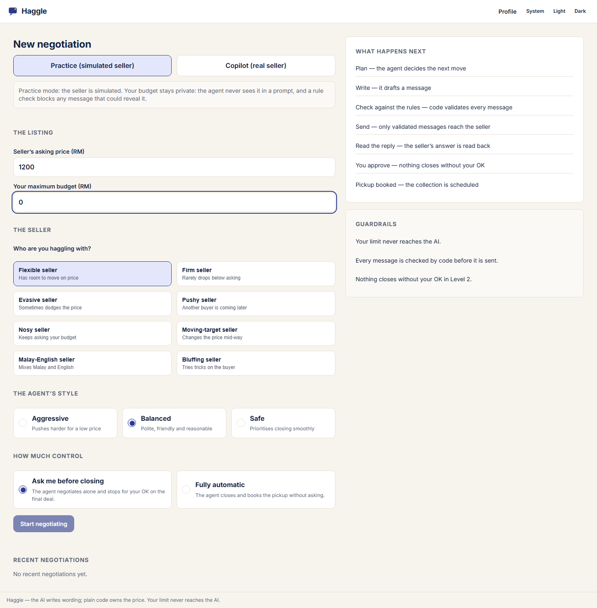
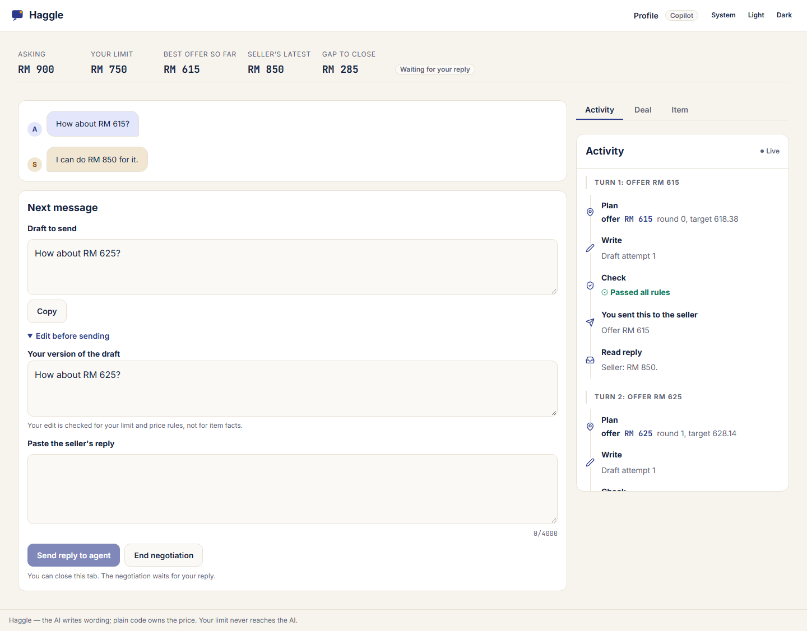

# Haggle

Haggle is an AI buyer's agent that negotiates the price of second-hand items on your behalf.
It plays two roles:

- **Practice mode:** haggles against a simulated seller so you can rehearse before contacting
  anyone.
- **Copilot mode:** drafts every message for you; *you* send each one yourself to a real seller on
  another app, then paste the seller's reply back. Nothing is ever sent automatically, and your
  maximum budget never reaches the AI.

Finished Copilot negotiations can be remembered under an anonymous per-browser profile, and
completed deals surface as "Similar past deals" on Home and as private history notes on the Item tab
of an active Copilot run.
See also [docs/copilot-mode.md](docs/copilot-mode.md) and [docs/profile-memory.md](docs/profile-memory.md).


**Live demo:** https://haggle-xi.vercel.app

The demo runs on free hosting, so the first request after a quiet period can take up to a minute
while the backend wakes up. There is no login, so please keep it to a few test negotiations.

---

## Screenshots

| | |
|---|---|
|  |  |
|  |  |

Home, a run waiting for your approval, the Copilot composer, and the outcome of a finished deal.

---

## Key features

- **Two modes:** Practice (simulated seller, LangGraph-run) and Copilot (human-relayed, persisted in
  Postgres checkpoints so a run survives reloads and server restarts).
- **Human-in-the-loop:** nothing closes without your explicit "approve" (`approve_close` autonomy,
  shown in the UI as "Ask me before closing"). The agent negotiates and pauses at the close gate
  waiting for your OK; in Copilot mode it also pauses before every seller message so you can review
  and edit the draft.
- **Safety guards:** deterministic code validators block over-budget offers, price leaks, private
  limit phrases, and ungrounded item claims before any message reaches the seller.
- **Item facts + grounding:** from pasted listing text and seller replies, facts (condition, age,
  warranty, defects, accessories, size, refresh rate, storage, battery health) are extracted,
  reconciled across sources, and asserted against drafts.
- **Market check:** enter up to eight comparable prices; Haggle shows the median and where your
  asking price and limit sit relative to it.
- **Pickup coordination:** after a finished Copilot deal, propose and book free pickup slots
  (hourly, 10 am–7 pm Malaysia time, 24h+ ahead) through its own calendar — never a personal
  calendar, never the seller's device.
- **Profile memory (anonymous):** a 32-char hex id lives in browser `localStorage`
  (`haggle.profileId`) and is sent as `X-Profile-Id`. Preferences (style, pickup window, area) and
  finished Copilot deals are stored; Practice runs are never remembered. Use **Forget** per deal or
  **Clear my memory** to delete everything for the current id.
- **Research before offering:** when the seller has not stated a price, the agent can read the
  listing, check market statistics, search a small buying-guidance knowledge base (pgvector) and ask
  the seller a question. These tools are read-only and listed in [docs/tools.md](docs/tools.md).
- **Categories:** eight item categories (monitors, phones, laptops, cameras, consoles, furniture,
  appliances, other) define their keywords, extra item facts and guidance in one table; if you do
  not pick one, Haggle guesses it from the title.
- **Evaluation harness:** an offline suite compares Haggle's price strategy with simple baselines on
  frozen seller splits, with confidence intervals and a blind test that is scored once. See
  [Evaluation](#evaluation).
- **Test without an API key:** `HAGGLE_LLM=offline` swaps the language model for a rule-based
  stand-in, so the test suites and the browser tests never call a real model. Log lines carry the
  run id and never contain prompts, messages or your limit.


## Why not just ask a chat assistant?

A chat assistant is good at wording a message. Negotiating on someone's behalf needs more, and a chat
window cannot promise it:

- **Your limit stays private.** The model only writes wording; it never sees your maximum budget.
  Plain code decides every price and checks every message before it can be sent: no offer above your
  limit, no leaked limit, no invented item facts.
- **It acts, not only advises.** It keeps state across rounds, looks up market prices and buying
  guidance, asks the seller questions, pauses for your approval before anything closes, and books a
  pickup time without double-booking.
- **It is measured.** The price strategy and the safety checks are evaluated offline with blind rounds
  and paired confidence intervals, including where Haggle loses (see [Evaluation](#evaluation)).

I did not benchmark Haggle against ChatGPT or any live model. The comparisons below are against
simple policies.

---

## Architecture overview

The language model proposes; plain code validates and executes. The model writes the wording of a
message and proposes what it read in the seller's reply. Code owns the price, the rules a message
must pass, and every action with side effects. Full detail: [docs/architecture.md](docs/architecture.md).


| Decision | Owner |
|---|---|
| The price of the next offer | code (`core/strategy.py`) |
| The wording of a message | the model |
| Reading the seller's reply | the model proposes, code reconciles (`llm/guards.py`) |
| Whether a draft may be sent | code (`core/outbound.py`, `core/validate.py`, `knowledge/grounding.py`) |
| Which read-only lookup to run | the model chooses, code runs and validates (`tools.py`) |
| Booking a pickup | code, through a calendar MCP server |


## Evaluation

The price strategy and the safety checks are evaluated offline, without a language model, against
rule-based seller simulators written by the author. A negotiation is scored by the share of the
seller's room to move that the buyer captured (1.0 means bought at the seller's hidden floor). No
deal, an offer above the budget or a leaked limit counts as 0, so a policy cannot look good by
breaking rules. Intervals are 95% bootstrap intervals over independent cases (seller x budget
ratio), and comparisons are paired: the same negotiation under each policy.

**Round 1: blind test** (4 unseen sellers, 420 negotiations per policy, scored once, code version
`037a4ef`; full report in `eval/reports/final_test_report.md`):

| policy | deal rate | score [95% CI] | rule violations |
|---|---|---|---|
| haggle_balanced | 56% | 0.465 [0.263, 0.659] | 0% |
| b3_capped_ladder (budget-aware fixed ladder) | 83% | 0.519 [0.375, 0.644] | 0% |
| b2_fixed_discount (ignores the budget) | 100% | 0.380 [0.250, 0.514] | 57% |

Paired difference to b3: -0.053 [-0.289, +0.157], a tie. Against the seller who leaves after three
replies (`quick_walker`) Haggle closed 0 of 15 possible deals: its opening was too low and its
concessions too slow for an impatient seller.

**Round 2: a separate, labelled experiment** (a faster opening and flatter concessions, chosen on
development sellers only; 6 new sellers, 630 negotiations per policy, code version `1e0eb55`; plan
written before any change in `docs/eval_round2_plan.md`; report in
`eval/reports/round2_test_report.md`):

| policy | deal rate | score [95% CI] | rule violations |
|---|---|---|---|
| haggle_balanced_v2 | 52% | 0.455 [0.284, 0.628] | 0% |
| haggle_balanced (round 1 style) | 37% | 0.323 [0.168, 0.493] | 0% |
| b3_capped_ladder | 88% | 0.534 [0.439, 0.626] | 0% |
| b2_fixed_discount | 100% | 0.377 [0.266, 0.484] | 60% |

Paired: v2 minus round 1 style +0.132 [+0.024, +0.271]; v2 minus b3 -0.079 [-0.246, +0.073], a tie.
The success criterion declared in advance for impatient sellers (interval above zero) was missed:
+0.228 [+0.000, +0.459]. It is reported as not met.

| seller | patient? | v2 | b3 |
|---|---|---|---|
| moderate | yes | 0.677 | 0.469 |
| patient_soft | yes | 0.713 | 0.533 |
| patient_firm | yes | 0.551 | 0.333 |
| brisk_mid | no | 0.546 | 0.727 |
| short_fuse | no | 0.000 | 0.492 |
| brisk_firm | no | 0.000 | 0.556 |

**What this shows.** Haggle never broke a rule in either test round (the fixed-discount baseline broke
them in 57% to 60% of negotiations). It gets better prices than a fixed ladder from sellers who keep
negotiating, and it loses deals to sellers who leave quickly. Overall it ties the fair baseline; it is
safe and competitive, not better.

**What it does not show.** The sellers are simple simulators written by the author, not real people.
The round 2 sellers were written after the round 1 failure was known, so only round 1 was fully
blind, and six sellers give few independent cases. The language-model layer (wording, reading
messages) is not part of these numbers.

Reproduce (each split is documented in [Development](#development)):

```
python scripts/run_eval.py --split dev            # development sellers: tuning allowed
python scripts/run_eval.py --split test --final   # round 1: scored once, clean git tree required
python scripts/run_eval.py --split test2 --final  # round 2: same rule
```

---

## Tech stack

| Layer | Technology |
|-------|------------|
| Backend language | Python 3.12 |
| Backend framework | FastAPI |
| Workflow engine | LangGraph (state graph, Postgres checkpointer) |
| LLM client | OpenAI Python SDK (any OpenAI-compatible endpoint) |
| Database | Postgres (Supabase) with `pgvector` |
| Vector dimension | 384 (`BAAI/bge-small-en-v1.5` via fastembed) |
| Frontend | Vite + React 18 + TypeScript (strict), CSS modules |
| UI icons | lucide-react |
| Frontend unit tests | vitest |
| Frontend e2e | Playwright + axe-core (accessibility) |
| Backend tests | pytest |
| Lint | ruff (backend), eslint (frontend) |

Boundary adapters (MCP servers):
- `backend/app/boundaries/calendar_server.py` — `haggle-calendar` (propose/book/cancel pickup slots)
- `backend/app/boundaries/marketplace_server.py` — `haggle-marketplace` (open conversation, send offer/message)

---

## Prerequisites

- **Python 3.12** (with `pip` and `venv`)
- **Node.js** (developed on v24; any current LTS should work) and **npm**
- **Postgres with the pgvector extension**, reachable through `DATABASE_URL` (a Supabase project
  works; the first migration enables the extension)
- **A language model**, either an OpenAI-compatible endpoint (`LLM_MODEL`, `LLM_BASE_URL`,
  `LLM_API_KEY`) or the built-in offline stand-in (`HAGGLE_LLM=offline`, no key needed)

No Dockerfile, `docker-compose.yml` or CI workflow exists in the repo, so setup is local and manual.

---

## Quick start

Copy `.env.example` to `.env` and set `DATABASE_URL`. Then choose how the language model runs:

- **Real model:** set `LLM_BASE_URL`, `LLM_API_KEY` and `LLM_MODEL` (any OpenAI-compatible endpoint).
- **No API key, to try it out:** set `HAGGLE_LLM=offline`. A rule-based stand-in writes the messages:
  everything works, with plainer wording.

**PowerShell:**

```powershell
# backend
Copy-Item .env.example .env        # then edit .env
python -m venv .venv
.\.venv\Scripts\Activate.ps1
pip install -r requirements.txt
python scripts/migrate.py
python scripts/index_knowledge.py  # buying-guidance search; downloads a small embedding model once
python -m uvicorn backend.app.api.main:app --port 8000
```

**macOS/Linux:**

```bash
# backend
cp .env.example .env               # then edit .env
python3 -m venv .venv
source .venv/bin/activate
pip install -r requirements.txt
python scripts/migrate.py
python scripts/index_knowledge.py  # buying-guidance search; downloads a small embedding model once
python -m uvicorn backend.app.api.main:app --port 8000
```

Then, in a second terminal:

```
cd frontend
npm install
npm run dev
```

Open `http://localhost:5173`, choose **Practice** or **Copilot**, and start negotiating. The server
logs one `starting: llm_mode=...` line at startup, so you can see which model mode it is in. If you
skip `index_knowledge.py` everything still works; the agent just finds no buying guidance.

---

## Getting started (detailed)

### 1. Clone and configure

Create `.env` from `.env.example`:

**PowerShell:**

```powershell
Copy-Item .env.example .env
# edit .env — set DATABASE_URL at minimum
```

**macOS/Linux:**

```bash
cp .env.example .env
# edit .env — set DATABASE_URL at minimum
```

The API app (`backend/app/api/main.py`) calls `load_dotenv()` in its lifespan, so `.env` is loaded
automatically when you start the server — no manual export is required.

### 2. Backend setup

**PowerShell:**

```powershell
python -m venv .venv
.\.venv\Scripts\Activate.ps1
pip install -r requirements.txt
```

**macOS/Linux:**

```bash
python3 -m venv .venv
source .venv/bin/activate
pip install -r requirements.txt
```

Apply the database migrations:

**PowerShell:**

```powershell
python scripts/migrate.py
```

**macOS/Linux:**

```bash
python scripts/migrate.py
```

Optional: seed the listings/comparables/knowledge tables used by the market check and knowledge
base:

**PowerShell:**

```powershell
python scripts/seed.py
python scripts/seed_knowledge.py
python scripts/index_knowledge.py
```

**macOS/Linux:**

```bash
python scripts/seed.py
python scripts/seed_knowledge.py
python scripts/index_knowledge.py
```

### 3. Start the backend

**PowerShell:**

```powershell
$env:DATABASE_URL="<your database url>"
$env:LLM_MODEL="<your model name>"
$env:LLM_BASE_URL="http://localhost:11434/v1"
$env:LLM_API_KEY="not-needed"
python -m uvicorn backend.app.api.main:app --port 8000
```

**macOS/Linux:**

```bash
export DATABASE_URL="<your database url>"
export LLM_MODEL="<your model name>"
export LLM_BASE_URL="http://localhost:11434/v1"
export LLM_API_KEY="not-needed"
python -m uvicorn backend.app.api.main:app --port 8000
```

The app uses a live OpenAI-compatible model by default; set `HAGGLE_LLM=offline` to use the rule-based stand-in instead. Set
`DATABASE_URL`, `LLM_MODEL`, `LLM_BASE_URL`, and `LLM_API_KEY` in `.env` (loaded automatically)
or export them before starting uvicorn.

CORS defaults to `http://localhost:5173`; override with `CORS_ORIGINS`.

### 4. Start the frontend

**PowerShell:**

```powershell
cd frontend
npm install
npm run dev      # Vite dev server, defaults to http://localhost:5173
```

**macOS/Linux:**

```bash
cd frontend
npm install
npm run dev
```

The Vite dev server proxies `/api` to `http://127.0.0.1:8000` (`frontend/vite.config.ts`), so the
frontend and backend must run together.

---

## Configuration

Only `backend/app/settings.py` reads the environment (a test enforces it).

| Variable | Needed | Meaning |
|---|---|---|
| `DATABASE_URL` | yes | Postgres connection string |
| `LLM_BASE_URL`, `LLM_API_KEY`, `LLM_MODEL` | live model only | OpenAI-compatible endpoint, key and model name |
| `HAGGLE_LLM` | no | the exact word `offline` selects the rule-based stand-in; anything else (or unset) means the live model |
| `EMBED_MODEL` | no | embedding model for the knowledge search (default `BAAI/bge-small-en-v1.5`) |
| `LOG_LEVEL` | no | `DEBUG`, `INFO` (default), `WARNING` or `ERROR` |
| `CORS_ORIGINS` | no | comma-separated allowed browser origins (default `http://localhost:5173`) |

---

## Usage

### Start a negotiation (API)

```http
POST /negotiations
Content-Type: application/json
X-Profile-Id: <32-hex profile id, optional>

{
  "asking": 1200,
  "budget": 1000,
  "persona": "flexible",
  "style": "balanced",
  "autonomy": "approve_close",
  "seed": 0,
  "mode": "simulate",
  "item_title": "Dell 27 inch gaming monitor",
  "seller_opening": null,
  "category": "monitors",
  "listing_text": null,
  "comparables": null
}
```

Response:

```json
{ "id": "<run_id>" }
```

### Follow a run

- `GET /negotiations/{run_id}` — full snapshot (status, history, question gate, outcome, price,
  pickup, trace).
- `GET /negotiations/{run_id}/events` — SSE stream of trace events (`trace`, `gate`, `done`).
- `POST /negotiations/{run_id}/decision` with `{"verdict": "approve"}` — answer a pause gate.
- `POST /negotiations/{run_id}/reply` (Copilot) with `{"reply": "...", "sent_text": "..."}` — paste
  the seller's reply and what you actually sent.
- `GET /negotiations/{run_id}/pickup/options` and `POST /negotiations/{run_id}/pickup` — propose
  and book a pickup slot after a deal.

### Profile memory

- `GET /profile/preferences`, `PUT /profile/preferences` — save style / pickup window / area
- `GET /profile/deals` — finished Copilot deals
- `GET /profile/similar?title=...&category=...` — wording-matched past deals
- `DELETE /profile/deals/{run_id}` — forget one deal
- `DELETE /profile` — clear the whole profile

All profile endpoints require `X-Profile-Id`.

### How the LangGraph workflow runs

Nodes (in `backend/app/graph/nodes.py`, built by `build_graph` in `builder.py`):

1. **plan** — strategy decides offer / accept / walk away / ask question (never talks to the seller
   directly).
2. **clarify** (optional) — tool loop: read listing, market stats, knowledge base, or ask the
   seller one question; capped at 4 tool steps / 2 questions.
3. **compose** — LLM drafts the buyer message from the decision + public context (budget never in
   the prompt).
4. **validate** — deterministic gate: no over-budget/above-asking offers, no price leaks, no
   ungrounded item claims. Rejected drafts are retried then replaced by a code fallback.
5. **execute** — send to the seller (Practice) or pause with the draft for the human to relay
   (Copilot `approve_close`); on accept there is a close-deal approval gate.
6. **ingest** — read the seller's reply: price, acceptance, walk-away, budget probe, pressure,
   term change. Phantom deals are rejected; only the buyer's own offered price counts.
7. **finalize** — outcome: deal / we_walk / seller_walks / timeout.
8. **schedule** (when a calendar is wired and the run is a deal) — propose and book the earliest
   free pickup slot; a failure never undoes the deal.

Interrupts (human-in-the-loop): `close_deal` (approve the final price) and `book_pickup` (confirm
the slot).

---

## Project structure

```
backend/app/    api (HTTP + SSE), graph (LangGraph), core (strategy and rules), llm, knowledge,
                memory, boundaries (MCP servers), sim (seller simulators), evaluation
backend/tests/  pytest suite (runs offline)
db/migrations/  SQL migrations, applied by scripts/migrate.py
knowledge/      buying-guidance documents, one per category plus general.md
frontend/       Vite + React + TypeScript app, vitest unit tests, Playwright e2e
eval/reports/   committed evaluation reports (round 1 and round 2)
docs/           architecture, tools, Copilot mode, profile memory, evaluation plan
scripts/        migrations, indexing, evaluation, demos
```

The full annotated map is at the end of [docs/architecture.md](docs/architecture.md).

---

## Development

### Backend

**PowerShell:**

```powershell
ruff check .
.\.venv\Scripts\python.exe -m pytest backend/tests -q --ignore=backend/tests/test_db.py
```

**macOS/Linux:**

```bash
ruff check .
python -m pytest backend/tests -q --ignore=backend/tests/test_db.py
```

### Frontend

**PowerShell:**

```powershell
cd frontend
npm run lint
npm test
npm run build
npm run preview
npm run e2e
```

**macOS/Linux:**

```bash
cd frontend
npm run lint
npm test
npm run build
npm run preview
npm run e2e
```

The backend suite runs entirely offline (`backend/tests/conftest.py` sets `HAGGLE_LLM=offline`).
At the time of writing: 489 backend tests, 97 frontend unit tests and 50 end-to-end tests.
Playwright runs at 1440×900 in light theme only. The e2e suite starts the FastAPI backend (with the
offline model) and the Vite dev server itself (`frontend/e2e/global-setup.ts`) and cleans negotiation
runs and profile rows afterwards (`frontend/e2e/global-teardown.ts` -> `scripts/delete_run.py` /
`scripts/delete_profiles.py`). The full suite takes about 25 minutes against a hosted Postgres,
because every graph step writes a checkpoint; run one file with `npx playwright test e2e/category.spec.ts`.

### Evaluation scripts

From the repo root:

```
python scripts/run_scenarios.py
python scripts/run_eval.py --split dev
python scripts/run_eval.py --split test --final
python scripts/run_eval.py --split test2 --final
python scripts/compare_b1.py
python scripts/eval_grounding.py
```

`run_eval.py` runs offline (no model calls). The `test` and `test2` splits are scored once: the script
refuses to run them without `--final`, on a dirty git tree, or a second time for the same code
version. Development runs write `eval/reports/dev_*` (ignored by git); the two committed reports are
`final_test_report.md` and `round2_test_report.md`. run_scenarios.py, compare_b1.py and
eval_grounding.py each take --live to use a real model; without it they use RuleBasedLLM or
NaiveBuyerLLM test doubles and run offline.


## Limitations

- The evaluation uses rule-based seller simulators written by the author. It does not show how real
  sellers react, and it does not evaluate the language model's wording.
- Haggle loses deals to sellers who leave quickly (round 2: 0 deals against `short_fuse` and
  `brisk_firm`). The score counts a missed deal as 0.
- The price strategy does not use the comparable prices you enter; they feed the market check only.
- The simulated seller does not answer the agent's questions; it replies with its price.
- Your own edits to a draft are checked against your limit but not fact-checked against the item.
- The calendar is Haggle's own. It does not connect to Google Calendar or any personal calendar.
- No marketplace is connected. In Copilot mode you relay every message yourself.
- Similar past deals are matched by wording, not by meaning. The `other` category, and categories
  that have no extra item facts, get general guidance only.
- The anonymous profile is a random id kept in the browser. There are no accounts, and anyone who has
  the id can read that profile.
- Speed: a Practice run takes about 13 seconds with the offline model, mostly checkpoint writes to the
  database; concurrent runs are slower. With a live model, calls are limited to 13 per minute
  (a fixed value in `LLMClient`).
- Prices are in RM and pickup times in Malaysia time (UTC+08:00).

---

## Deployment notes

The public demo is at https://haggle-xi.vercel.app (frontend on Vercel, backend on Render, database on Supabase).

The backend runs as a Render free web service (`render.yaml`) and the frontend on Vercel
(`frontend/vercel.json`). The backend needs a Postgres database with the pgvector extension
(Supabase works; use the Session pooler connection string). Set these env vars on Render:
DATABASE_URL, LLM_BASE_URL, LLM_API_KEY, LLM_MODEL, CORS_ORIGINS. Set VITE_API_BASE on Vercel
(the frontend build reads it at build time; leave empty to use the dev proxy to /api).
The deployed demo uses the live model, with the key stored only in Render's settings. There is no
login, so anyone with the URL can start runs and use the model quota (calls are limited to 13 per
minute per server process). The free service sleeps when idle, so the first request after a gap is
slow.

---

## Troubleshooting

- **`DATABASE_URL` not set:** the server fails to start. Set it in `.env` (loaded automatically)
  or export it before running uvicorn.
- **Frontend can't reach the API:** confirm the backend is on `http://127.0.0.1:8000`; the Vite
  proxy target is hardcoded there in `frontend/vite.config.ts`.
- **Profile memory 503:** `DELETE /profile` is a safe no-op for an unknown id; a 503 means the
  memory dependency isn't reachable — retry or check the database.
- **Run stuck at a gate:** Copilot runs pause at `close_deal` (and `seller_reply` for each draft)
  until you answer via `POST /negotiations/{run_id}/decision` or `/reply`. The SSE stream
  (`/events`) shows the current gate.
- **No similar deals shown:** similarity is wording-based (not semantic), and only finished Copilot
  deals with a final price qualify; Practice runs are never remembered.
- **The agent never gives buying guidance:** run `python scripts/index_knowledge.py` once, and check
  the server log for `knowledge search failed` or `embedder could not be created` warnings.
- **Unsure which model the server uses:** read the `starting: llm_mode=...` line the server logs at
  startup. Only the exact value `HAGGLE_LLM=offline` selects the offline stand-in.

---

## Contributing

1. Fork the repo and create a branch.
2. Make changes, keeping tests green:
   - `ruff check .` + backend pytest
   - `npm run lint` + `npm test` + `npm run e2e` (frontend)
3. Do not commit secrets; `.env` is local-only and `.env.example` contains names only.
4. Open a pull request describing the change and which scenarios/eval splits it affects.

### License

MIT. See [LICENSE](LICENSE).
