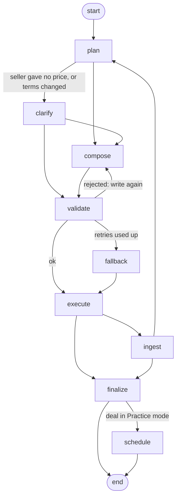

# Architecture

Haggle is a buyer-side negotiation agent. One rule shapes the whole design: **the language model
proposes, plain code validates and executes.** The model writes the wording of a message and proposes
what it read in the seller's reply. Code owns the price, the rules a message must pass, and every
action with side effects.

## Who decides what

| Decision | Owner | Where |
|---|---|---|
| The price of the next offer | code | `core/strategy.py` (`decide`, styles aggressive / balanced / safe) |
| The wording of a message | the model | `llm/tasks.py` |
| Reading the seller's reply (price, accepted, walked away, asks for budget, pressure, changed terms) | the model proposes, code reconciles | `llm/tasks.py`, `llm/guards.py` (phantom-deal guard) |
| Whether a draft may be sent | code | `core/outbound.py`, `core/validate.py`, `knowledge/grounding.py` |
| Which read-only lookup to run before replying | the model chooses, code runs and validates | `llm/clarify.py`, `tools.py` |
| Booking a pickup | code, through an MCP calendar server | `boundaries/calendar_*.py` |

Your maximum budget never reaches a prompt: the model sees only the public view of the negotiation
context (`NegotiationContext.public_view()` in `core/models.py`). A draft that breaks a rule is sent
back to the model; if it keeps failing, a safe template message is used instead (`fallback`).

## The graph



`graph/builder.py` wires the nodes (`graph/nodes.py`). State lives in `graph/state.py`.

## Two modes

**Practice** runs against a simulated seller (`sim/seller.py`, personas in `sim/personas.py`) through
`SimSellerPort`. A finished deal is booked into the calendar automatically.

**Copilot** talks to a real seller through a human. `ManualSellerPort` (`graph/manual.py`) pauses the
graph with an interrupt for every message: the human sends the draft elsewhere and pastes the reply
back (`seller_reply` gate, with `kind` "offer" or "question"). Closing a deal waits at a `close_deal`
gate. In Copilot the agent states only facts from the listing or the seller (`ground=True`), and a
pickup is arranged after the deal through the API, never by the graph.

## Persistence and resume

The service keeps no state of its own. Graph state is stored by a Postgres checkpointer (a connection
pool that checks connections before use) and the run configuration in the `runs` table, so a server
restart loses nothing. A run's status is derived from the stored state: `running`, `waiting_for_approval`,
`finished`, `failed`, `stalled` (cut off mid-step: `POST /resume` continues it) or `lost` (no
checkpoint). The browser follows a run through a server-sent-events stream that polls the checkpoint.
A test kills a worker mid-run and resumes it.

## Boundaries (MCP)

The calendar is an MCP server in a separate process that receives only `DATABASE_URL`
(`boundaries/calendar_server.py`). Slots are hourly, 10:00 to 19:00 Malaysia time, at least 24 hours
ahead. Booking is idempotent: the key is `<run_id>:pickup`, so a retry never books twice.
## Boundaries (MCP)

The calendar is an MCP server in a separate process that receives only `DATABASE_URL`
(`boundaries/calendar_server.py`). Slots are hourly, 10:00 to 19:00 Malaysia time, at least 24 hours
ahead. Booking is idempotent: the key is `<run_id>:pickup`, so a retry never books twice.

`boundaries/marketplace_server.py` is the simulated seller-facing MCP server. It is started by the
API only when `MARKETPLACE_CHANNEL=on` is set (`backend/app/api/main.py:218`); otherwise it appears
as `off` with no tools (`main.py:222-231`). The calendar server is always started (`main.py:217`).
The marketplace exposes `open_conversation`, `send_offer`, `send_message` and `get_conversation`
(`marketplace_server.py:44-122`). `McpSellerPort` (`boundaries/ports.py:13-61`) wraps it with
`opening_text`, `send_offer` and `send_message`; `ApprovedMcpSellerPort` (`boundaries/ports.py:64-117`)
adds an explicit interrupt at the `seller_reply` gate so every outgoing draft waits for human
approval before being sent (`builder.py:78`). Conversation state (`conversation_id` = run id) is
rebuilt from earlier turns via `replay_json` on restart, and `open_conversation`/`send_offer` are
idempotent by turn number. Call recording goes through `CallRecorder` (`boundaries/recorder.py:38-74`),
a ring buffer (last 500) that keeps only `turn`, `price`, `start`, `slot`, `kind`, `start_at`,
`from_iso`, `count` and `conversation` (first 8 chars of `conversation_id`); message text and the
hidden floor/reserve/patience are never recorded. Read-only endpoints: `GET /connections`,
`GET /negotiations/{run_id}/mcp-calls` and `GET /negotiations/{run_id}/seller-view` (409 for
non-marketplace runs).

## Research before the first offer

When the decision is an offer and the seller has not stated a price (or the terms changed), the graph
runs a bounded clarify loop. The model picks one read-only tool per step: `get_listing`,
`get_market_stats`, `search_knowledge`, `ask_seller`, or stop. Code runs the tool and validates the
choice. `tools.py` is the single registry of these tools; `docs/tools.md` is generated from it by
`scripts/render_tools_doc.py`.

## Categories and knowledge

`knowledge/categories.py` holds one table of eight categories (name, label, keywords, extra item
facts). It drives the API schema, the category guess from the title, the extra facts that are
extracted, and the documents indexed. Documents in `knowledge/*.md` (one per category plus
`general.md`) are embedded with `BAAI/bge-small-en-v1.5` (384 dimensions, `fastembed`) into the
`knowledge_chunks` table by `scripts/index_knowledge.py`. A search covers the item's category plus
general guidance. The embedder is created on first use, a failed search returns nothing and is logged,
and a failed embedder is retried only after 60 seconds. Sixteen frozen queries check retrieval
(top-1 hit on 15, top-3 hit on all 16 at the time of writing).

## Profile memory

An anonymous profile id (kept in the browser) stores preferences and finished Copilot deals
(`memory/`). Only numbers and short notes reach a prompt. Practice runs are never remembered. A memory
failure is counted and logged and never fails a negotiation. See `docs/profile-memory.md`.

## Settings, the offline model, logging

`settings.py` is the only place that reads the environment (a test enforces it; the calendar server,
a separate process, is the one allowed exception). The model is live by default. The exact value
`HAGGLE_LLM=offline` selects `RuleBasedLLM`, a rule-based stand-in that plays the same roles; the test
suites and the e2e backend use it, so nothing in testing calls a real model.
Logging (`logs.py`) writes one plain-text line per event under the `haggle.*` loggers, tagged with the
run id. The rule: log what happened (task, timing, counts, error type), never content (prompts,
messages, budgets, URLs, keys). A test scans the app for `print`, and others check that no log line
contains private values.

## Evaluation design

`backend/app/evaluation/` evaluates the price strategy and the safety checks offline, without a
language model. Sellers are split into development, test and test2 (`sim/personas.py`); tuning uses
development sellers only. A negotiation scores the share of the seller's room to move that the buyer
captured; no deal or a broken rule scores 0. Intervals are cluster bootstrap over seller x budget
ratio cases, and comparisons are paired. The protocol is frozen in `evaluation/protocol.py`: a final
split needs `--final`, a clean git tree, and is scored once per code version. Results and their
limits are in the README (Evaluation) and in `eval/reports/`.

## Repository map

```
backend/app/
  api/          FastAPI app, endpoints, SSE stream, background service, run store, schemas
  graph/        LangGraph builder, nodes, state, control (approve/decide), seller ports
  core/         strategy, outbound checks, action validator, pickup helpers, calendar rules
  llm/          client (OpenAI-compatible), offline stand-in, prompts, clarify tools, guards
  knowledge/    categories, fact extraction and grounding, retrieval, market stats, embedder, lookup
  memory/       anonymous profile memory
  boundaries/   MCP calendar and marketplace servers, MCP session and ports
  sim/          seller simulator and personas (dev / test / test2)
  evaluation/   policies, scenarios, runner, metrics, protocol, reports, round 2
  settings.py   the only reader of the environment
  tools.py      registry of the agent's tools
  logs.py       structured logging
backend/tests/  pytest suite (offline)
db/migrations/  001 to 007: users, vectors, row-level security, knowledge_chunks,
                calendar idempotency, runs, profile memory
knowledge/      one buying-guidance document per category plus general.md
scripts/        migrate, index_knowledge, run_eval, run_scenarios, demos, e2e cleanup helpers
eval/reports/   committed reports: final_test_report.md, round2_test_report.md, round2_tuning.md
frontend/src/   App, api client, SSE hook, lib (formatting, trace model, categories), ui (design
                system), features (home, listing, negotiation, profile)
frontend/e2e/   Playwright specs (category, copilot, flow, pickup, profile)
```
